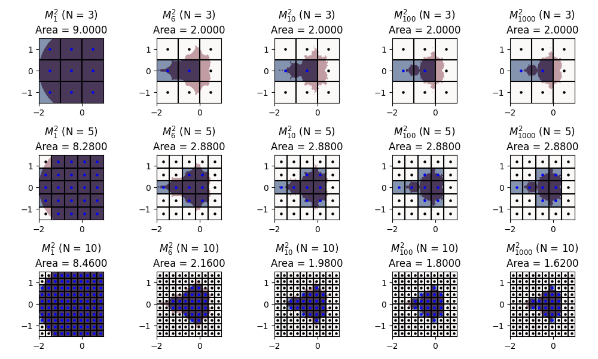

# APC 524 Assignment 4: `parallel-exercise`

This assignment involves speeding up a small script. You will do this in a compiled language of your choice (C, C++, or Fortran recommended), then parallelize it.

## Preliminary: Discretizing the Mandelbrot Set


The Mandelbrot Set is a fractal defined as the set of points on the complex plane for which the following recursion does not diverge to infinity:

$$\begin{matrix}z_0(c) = 0\\\\ z_k(c) = z_{k-1}^2 + c \\\\ c\in M \text{ iff } \sup_{k\in \mathbb{Z}^+} |z_k(c)| < \infty\end{matrix}$$

While many techniques have been designed to compute this set, we will stick to a simple rule: after some large number of iterations, we say that $c$ is *probably* in this set if $|z_k| \le L$ up to a given iteration and for a chosen $L$ (one can show that $L = 2$ is the best value for this). More formally, we define the sequence of sets:

$$M_{n}^{L} = \left \\{\max_{0 \le k \le n}|z_k(c)| \le L\right \\}$$

and take the Mandelbrot set to be $\bigcap_{n=0}^\infty M_{n}^L$, which is true for $L \ge 2$.

A script is provided in `src/mandelbrot_area.py` that takes an integer `num_iters` ($n$), a float `divergence_threshold` ($L$), and an integer `samples_per_axis` ($N$), and computes the area of the partial Mandelbrot set $M_n^L$ by discretizing it on the grid $[-2,1] \times [-1.5,1.5]$ at midpoints

$$\left\\{-2 + \frac{3}{N}(a + 0.5) + i\left(-1.5 + \frac{3}{N}(b + 0.5)\right): 0\le a,b < N\right\\}$$

The area is then estimated as $(3/N)^2$ times the number of points found inside $M_n^L$.



## Part 1: Compiled Code

Write a version of `src/mandelbrot_area.py` in a compiled language of your choice. It should agree with the python version up to 6 digits.

To test your code, we will clone your repository on `adroit`, and inside the root directory of the repository, run

```bash
./load_modules.sh
./compile_serial.sh
./run_serial.sh $(num_iters) $(divergence_threshold) $(samples_per_axis)
```

The script `load_modules.sh` is provided in case you need it, but you can leave it blank if `adroit` has everything you need already loaded.

> [!NOTE]
> In shell scripts, you can access these command line arguments as `$1` for `num_iters`, `$2` for `divergence_threshold`, and `$3` for `samples_per_axis`. You can assume that all arguments will always be provided in the right format.

## Part 2: Parallel Code

Write a *parallel* version of `src/mandelbrot_area.py` in a compiled language of your choice (in class we covered OpenMP and MPI, but you may choose to use a threading module if you like). It should agree with the python version up to 6 digits.

To test your code, we will clone your repository on `adroit`, and inside the root directory of the repository, run

```bash
./load_modules.sh
./compile_parallel.sh
./run_parallel.sh $(num_iters) $(divergence_threshold) $(samples_per_axis) $(num_workers)
```

The script `load_modules.sh` is provided in case you need it, but you can leave it blank if `adroit` has everything you need already loaded.

## Grading

For full credit, we should be able to run, on adroit:

```bash
git clone {your repository}
cd {your repository}
./load_modules.sh
./compile_serial.sh
./compile_parallel.sh
uv sync --group test
uv run pytest
```

You can assume that `uv` is already properly configured. Note that both compile scripts are run before execution, so make sure that the serial and parallel executables are separately named.

> [!NOTE]
> Example codes for computing π can be found [in the repository of the course page](https://github.com/se-for-sci/se-for-sci.github.io/tree/main/content).
